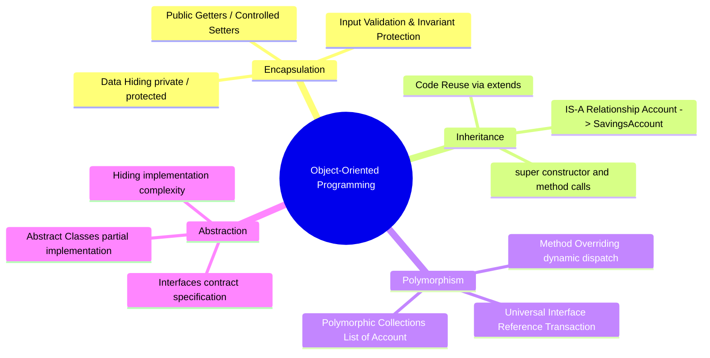
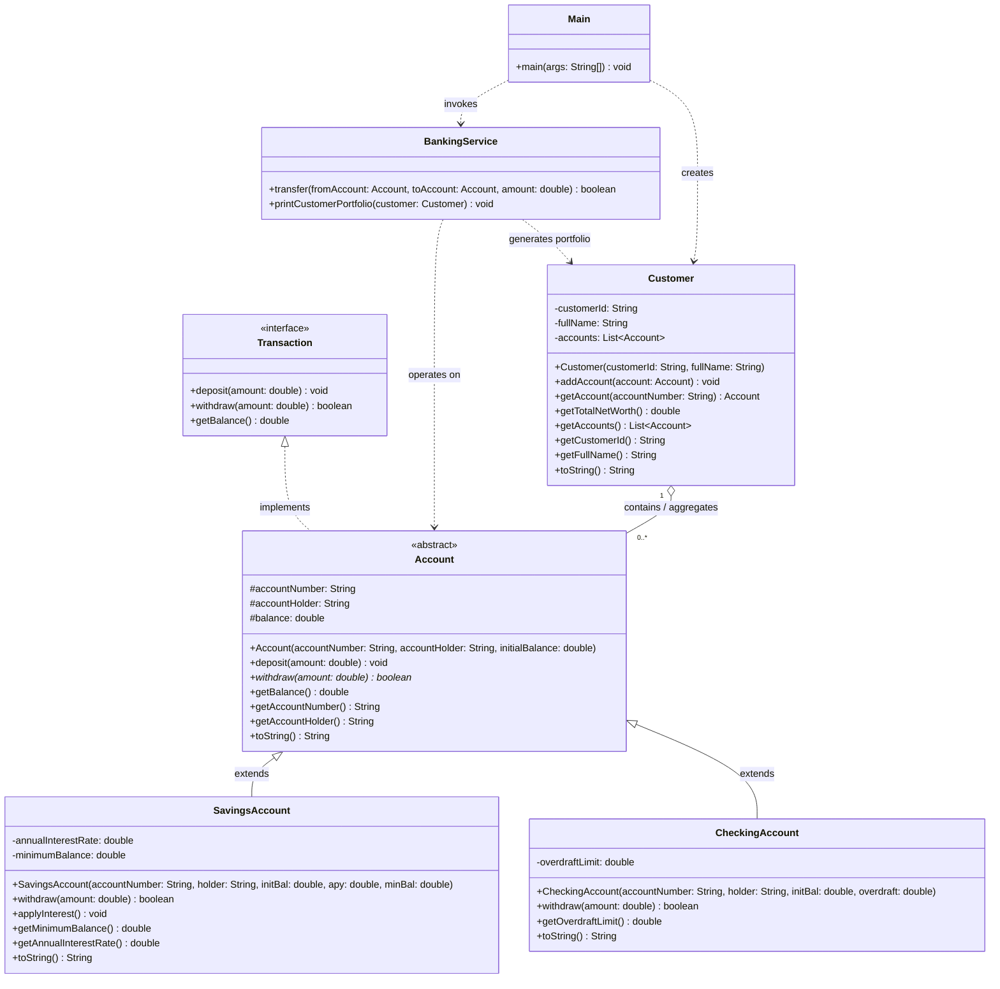
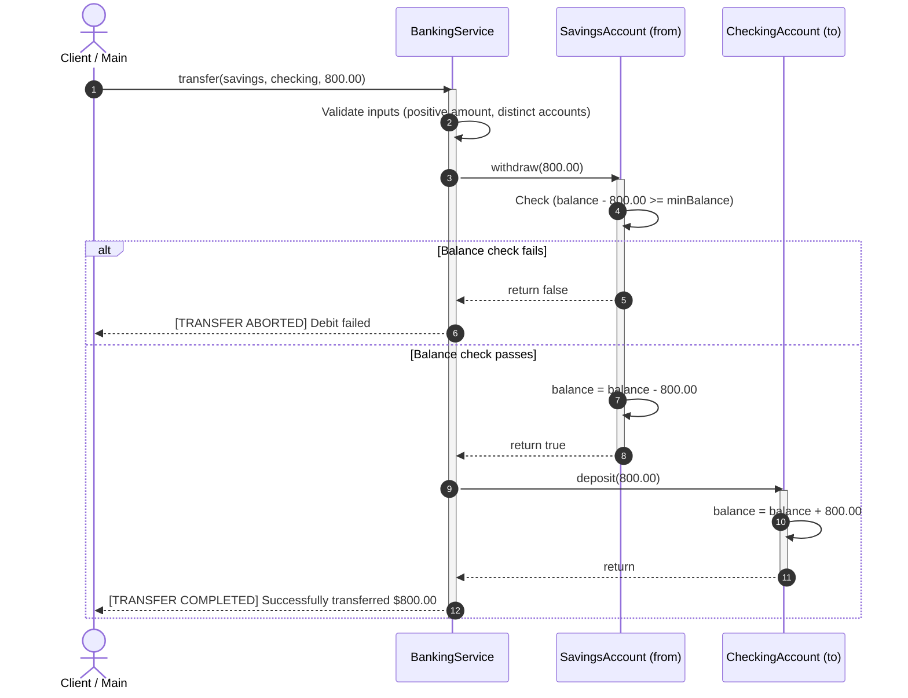

# Week 3: Object-Oriented Programming in Java — Banking System Project

Welcome to the **Week 3 Object-Oriented Programming (OOP) in Java** repository. This project models a robust, enterprise-style **Banking System** demonstrating the four pillars of OOP (Encapsulation, Inheritance, Polymorphism, and Abstraction) along with interface design, business validations, and UML modeling.

---

## 🏛️ Core OOP Concepts Explained



### 1. Encapsulation (Data Hiding & Validation)
- Encapsulation bundles state (fields) and behavior (methods) together while restricting direct access to internal details.
- In this project:
  - Account balances cannot be modified directly (`balance` cannot be directly set to arbitrary numbers).
  - Deposits must be strictly positive ($> 0$).
  - Customer accounts list is protected from direct external tampering using unmodifiable views (`Collections.unmodifiableList`).

### 2. Abstraction (Contracts & Partial Implementations)
- **Interface (`Transaction`)**: Specifies *what* operations must exist (`deposit()`, `withdraw()`, `getBalance()`) without dictating *how* they are implemented.
- **Abstract Class (`Account`)**: Implements shared state (`accountNumber`, `accountHolder`, `balance`) and generic `deposit()`, while leaving `withdraw()` abstract so each concrete account type can enforce its own domain rules.

### 3. Inheritance (Code Reuse & Hierarchy)
- `SavingsAccount` and `CheckingAccount` use the `extends` keyword to inherit identity, storage, and standard methods from `Account`.
- Eliminates redundant code and establishes an **IS-A** relationship (`SavingsAccount` IS-A `Account`).

### 4. Polymorphism (Dynamic Method Dispatch)
- The method `withdraw(double amount)` behaves differently depending on the runtime type:
  - `SavingsAccount.withdraw()` verifies that the balance does not drop below the minimum required balance.
  - `CheckingAccount.withdraw()` allows balances to drop below zero up to the overdraft limit.
- The `BankingService.transfer(Account from, Account to, double amount)` method operates on base `Account` references, allowing any combination of account types to transfer funds seamlessly.

---

## 📊 UML Class Diagram



---

## 🔄 Sequence Diagram: Inter-Account Transfer Flow



---

## 📁 Project Directory Structure

```
week3/
├── bin/                       # Compiled .class bytecode
│   └── com/
│       └── banking/
│           ├── model/
│           │   ├── Account.class
│           │   ├── CheckingAccount.class
│           │   ├── Customer.class
│           │   └── SavingsAccount.class
│           ├── service/
│           │   ├── BankingService.class
│           │   └── Transaction.class
│           └── Main.class
├── src/                       # Java source code
│   └── com/
│       └── banking/
│           ├── model/
│           │   ├── Account.java          # Abstract class with shared fields and validation
│           │   ├── CheckingAccount.java  # Overdraft protection logic
│           │   ├── Customer.java         # Multi-account customer portfolio model
│           │   └── SavingsAccount.java   # Minimum balance rule & interest calculations
│           ├── service/
│           │   ├── BankingService.java   # Polymorphic transfer and reporting operations
│           │   └── Transaction.java      # Base financial contract interface
│           └── Main.java                 # Comprehensive scenario test runner
└── README.md                  # Complete documentation with UML diagrams
```

---

## 🚀 How to Compile and Run

### 1. Compile the Project
From the `week3` directory:
```powershell
javac -d bin src\com\banking\service\*.java src\com\banking\model\*.java src\com\banking\Main.java
```

### 2. Execute the Banking System Demonstration
```powershell
java -cp bin com.banking.Main
```

### 3. What the Demo Demonstrates:
1. **Customer Portfolio Initialization**: Registering multiple accounts under one customer.
2. **Encapsulated Deposits**: Crediting funds and verifying updated balances.
3. **Savings Account Enforcement**:
   - Successful withdrawal maintaining required minimum balance.
   - Rejection when a withdrawal would breach the \$500.00 minimum threshold.
   - Monthly interest compounding based on annual percentage yield.
4. **Checking Account Overdraft**:
   - Withdrawal exceeding positive balance by drawing into approved overdraft.
   - Rejection when requested amount exceeds total available funds plus overdraft limit.
5. **Polymorphic Inter-Account Transfer**:
   - Transferring funds between Savings and Checking accounts atomically.
   - Rolling back in case of validation failures.
6. **Portfolio Net Worth Audit**:
   - Dynamic calculation of customer's consolidated net worth across all held accounts.

---
